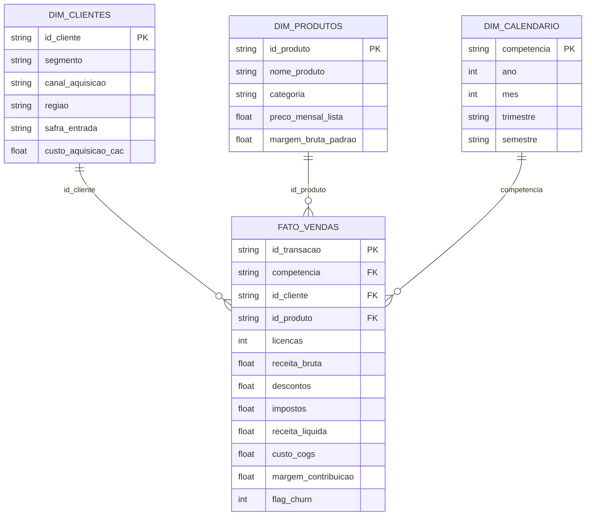

# 📊 Executive BI & Revenue Analytics — Star Schema, SQL, Python & Streamlit

[](#)
[](#)
[](#)
[%20%26%20PDF-217346)](#)

Projeto ponta a ponta de **Business Intelligence (BI) e Análise de Dados Comerciais e Financeiros**, estruturado em **Modelagem Dimensional (Star Schema)** para consumo em **Power BI / Tableau / Streamlit**, consultas **SQL Analíticas** e automação de relatórios executivos em **Excel (`.xlsx`)** e **PDF (`.pdf`)** via Python.

---

## 🎯 Problema de Negócio e Indicadores Monitorados

Diretorias comerciais, financeiras (FP&A) e de operações de empresas B2B/SaaS precisam consolidar métricas de receita recorrente, eficiência de aquisição e retenção de clientes em uma única fonte governada:

* **DRE Gerencial Mensal:** Evolução de `Receita Bruta`, `Descontos`, `Impostos`, `Receita Líquida`, `COGS` e `Margem de Contribuição (R$ e %)`.
* **Unit Economics por Canal e Segmento:** Cálculo de `CAC` (Custo de Aquisição de Cliente), `LTV` (Lifetime Value baseado em margem), `Razão LTV/CAC` e `Payback do CAC (meses)`.
* **Retenção e Churn (Análise de Safra / Cohort):** Acompanhamento da retenção de clientes e expansão de receita por safra de entrada (`safra_entrada`).

---

## 🏗️ Arquitetura do Modelo Dimensional (Star Schema)



---

## 📁 Estrutura do Repositório

```text
executive-bi-revenue-analytics/
├── pipeline_bi_analytics.py                  # Pipeline principal: gera Star Schema, roda SQL e exporta Excel/PDF
├── app_dashboard_bi.py                       # Dashboard interativo em Streamlit + Pandas
├── sql/
│   └── analise_bi_star_schema.sql            # Queries SQL de DRE, Unit Economics (LTV/CAC) e Cohort
├── data_warehouse/                           # Tabelas Star Schema geradas (.csv prontos para Power BI + SQLite)
│   ├── dim_calendario.csv
│   ├── dim_clientes.csv
│   ├── dim_produtos.csv
│   └── fato_vendas.csv
├── relatorios_bi/                            # Entregáveis executivos gerados automaticamente
│   ├── painel_executivo_dre_e_kpis.xlsx
│   └── relatorio_comite_comercial_bi.pdf
└── src/
    ├── xlsx_simples.py                       # Motor nativo de geração de planilhas Excel (.xlsx)
    └── pdf_simples.py                        # Motor nativo de geração de relatórios executivos (.pdf)
```

---

## 🚀 Como Executar

### 1. Rodar o Pipeline Completo de BI (Star Schema + SQL + Excel + PDF)
Não requer dependências externas (100% biblioteca padrão do Python 3.10+):
```bash
python pipeline_bi_analytics.py
```

### 2. Abrir o Dashboard Interativo no Navegador (Streamlit)
```bash
pip install streamlit pandas
streamlit run app_dashboard_bi.py
```

### 3. Conectar no Power BI
Importe os 4 arquivos CSV da pasta [`data_warehouse/`](data_warehouse) (`dim_calendario.csv`, `dim_clientes.csv`, `dim_produtos.csv` e `fato_vendas.csv`) no **Power BI Desktop** — os relacionamentos `1:N` do Star Schema são detectados automaticamente.
